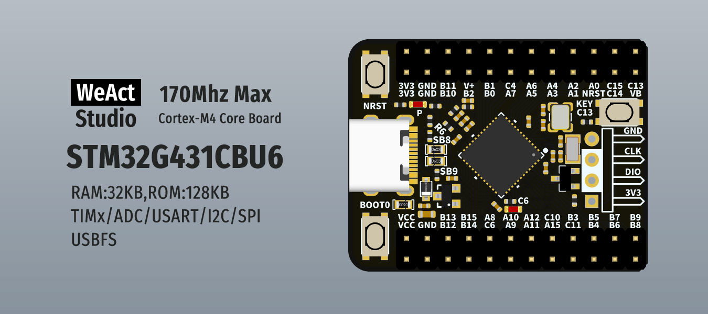
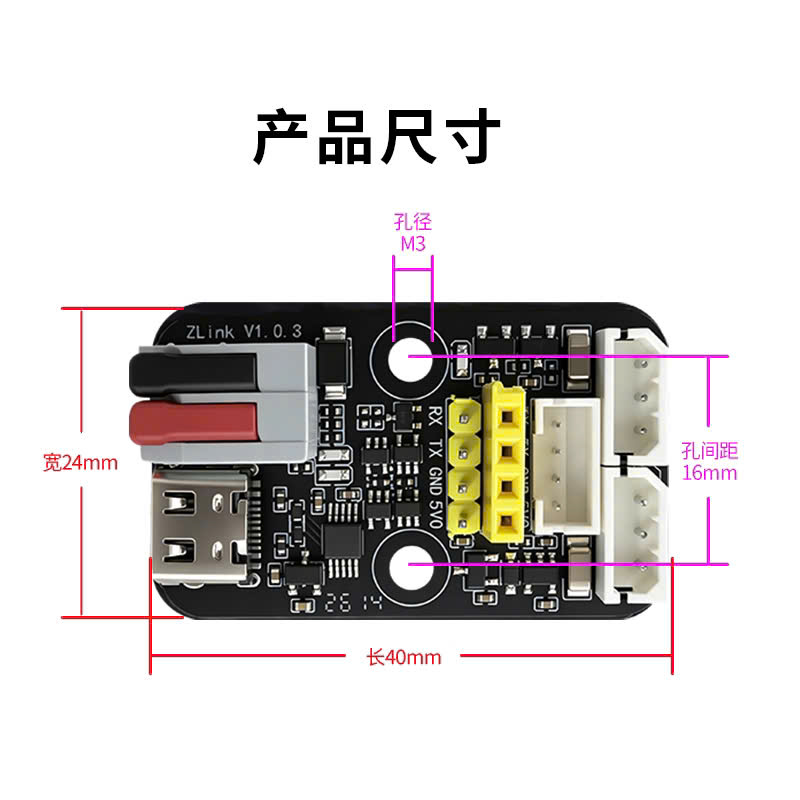
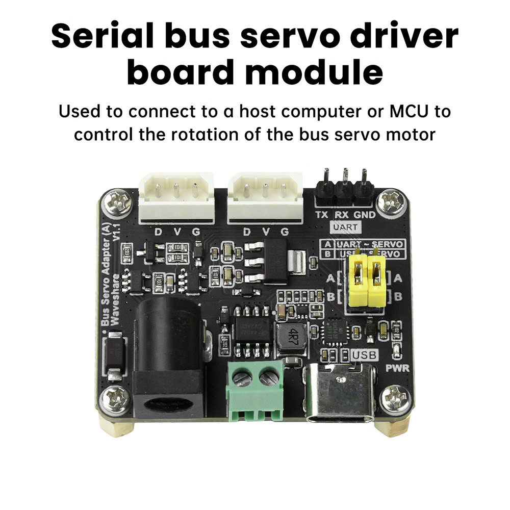
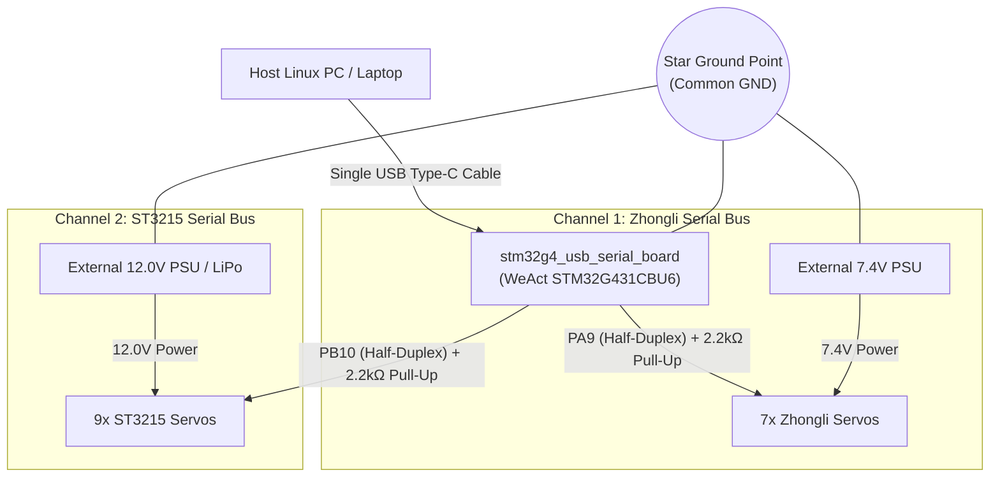

<!-- LANGUAGE SWITCHER -->
<p align="right">
  <b>English</b> | <a href="README_vi.md">Tiếng Việt</a>
</p>

# stm32g4_usb_serial_board

<p align="center">
  
  
  
  
  
</p>

<p align="center">
  <b>High-Speed Intelligent Dual-Channel USB Bridge for Zhongli and Waveshare ST3215 Serial Bus Servos in Robotics.</b>
</p>

<p align="center">
  
</p>

---

## 🌟 What is this Project & What Problem Does It Solve?

In advanced mobile manipulation robots (such as omnidirectional mobile bases equipped with a 7-DOF articulated arm), robotics engineers frequently have to drive two distinct families of serial bus servos:
1. **Zhongli Smart Servos:** ASCII-based command frames (e.g. articulated robotic arms).
2. **Waveshare ST3215 / Feetech STS Servos:** High-speed binary protocol polled at 100 Hz (e.g. omnidirectional drive wheels and LeKiwi robot joints).

<p align="center">
  
  &nbsp;
  
</p>

Attempting to drive both networks using off-the-shelf single-port USB-UART dongles or bridging them onto a single wire leads to severe operational hazards:
- Protocol collision between binary STS frames (`0xFF 0xFF ...`) and ASCII text strings (`#001P...`).
- High round-trip latency (>30 ms), causing jerky motion and erratic wheel slip.
- Host USB driver drops and port conflicts under high transaction rates.

**`stm32g4_usb_serial_board`** solves this challenge by turning the 32-bit **STM32G431CBU6 microcontroller (ARM Cortex-M4F @ 170 MHz)** into a **Hardware-Isolated Dual-Channel USB Bridge**:
- **Channel 1 (`/dev/zhongli_serial`):** Dedicated `USART1` (PA9) Half-Duplex Open-Drain @ 1 Mbps for Zhongli servos.
- **Channel 2 (`/dev/lekiwi_serial`):** Dedicated `USART3` (PB10) Half-Duplex Open-Drain @ 1 Mbps for Waveshare ST3215 servos.
- Connecting a **single USB Type-C cable** to the Host PC provides **two independent virtual COM ports** operating concurrently with **$0.00\%$ baudrate error**!

---

## ⚡ Why is this Bridge Superior?

| Metric / Feature | Generic USB-UART Dongle / Legacy Z-Link | This Project (`stm32g4_usb_serial_board`) |
| :--- | :--- | :--- |
| **Channel Count** | Single channel only | 🚀 **Dual independent concurrent channels (Dual CDC)** |
| **Supported Servos** | 1 fixed servo type | ✅ **Simultaneous Zhongli (ASCII) & ST3215 (Binary STS)** |
| **Control Smoothness**| Stuttering, high jitter (10–20 Hz) | ⚡ **Ultra-smooth 100 Hz closed-loop (<1.2 ms round-trip)** |
| **Baudrate Accuracy** | 2–3% framing error at 1 Mbps | 🎯 **100% precision (0.00% baudrate error at 170 MHz)** |
| **Echo Suppression**  | Self-echo corrupts RX buffer | 🛡️ **Hardware RE Muting in <10 ns during DMA TX** |
| **ROS 2 Integration** | Fragile `/dev/ttyUSB*` renumbering | 🤖 **Single USB cable with persistent static udev symlinks** |

---

## 🔌 Robot Interconnection Diagram

The overall system wiring is clean, robust, and electrically isolated:




### Essential Wiring Rules:
1. **Channel 1 Signal (Zhongli):** Connect Pin **`PA9`** (Header P1 - Pin 11) to the yellow servo Data line with a $2.2\text{ k}\Omega$ pull-up resistor to 3.3V or 5V.
2. **Channel 2 Signal (ST3215):** Connect Pin **`PB10`** (Header P2 - Pin 14) to the yellow/white servo Data line with a $2.2\text{ k}\Omega$ pull-up resistor to 3.3V or 5V.
3. **Power & Grounding:** Keep 7.4V and 12V power rails completely separate, but **bond all negative (GND) terminals together at the STM32 GND pin** (Star Grounding topology).

> ⚠️ **Safety Warning:** Never attempt to power servos from the USB 5V rail. A multi-servo chain can draw between 5A and 10A under peak torque, which will immediately damage the computer's USB port!

---

## 🚀 Quickstart Guide

### Step 1: Install Persistent udev Rules on Linux
Copy the project udev rule to establish persistent symlinks:
```bash
sudo cp udev_rules/99-dual-servo-bridge.rules /etc/udev/rules.d/
sudo udevadm control --reload-rules && sudo udevadm trigger
```

### Step 2: Plug in the USB Type-C Cable
Verify device enumeration:
```bash
ls -l /dev/zhongli_serial /dev/lekiwi_serial
```
Expected output:
- `/dev/zhongli_serial` $\rightarrow$ Virtual COM port for Zhongli servos.
- `/dev/lekiwi_serial` $\rightarrow$ Virtual COM port for Waveshare ST3215 servos.

The blue user LED (`PC6`) will blink at 1 Hz indicating healthy firmware execution.

### Step 3: Test Internal Serial Communication

#### Test Channel 1: Zhongli ASCII Protocol (`/dev/zhongli_serial`)
Open serial terminal via `picocom`:
```bash
picocom -b 1000000 /dev/zhongli_serial
```
Send angle query command:
```text
#001PRAD!
```
The servo will respond immediately:
```text
#001P1500!
```

#### Test Channel 2: Waveshare ST3215 Binary Protocol (`/dev/lekiwi_serial`)
Verify the 1 Mbps half-duplex binary loop directly with a Ping packet using Python (`pyserial`) without any ROS middleware:
```bash
python3 -c "
import serial
ser = serial.Serial('/dev/lekiwi_serial', 1000000, timeout=0.05)
# Ping Servo ID 1: Header [0xFF, 0xFF], ID [0x01], Len [0x02], Ping [0x01], Checksum [0xFB]
ping_pkt = bytearray([0xFF, 0xFF, 0x01, 0x02, 0x01, 0xFB])
ser.write(ping_pkt)
resp = ser.read(6)
print('ST3215 Ping Response:', [hex(b) for b in resp])
# Expected response: ['0xff', '0xff', '0x1', '0x2', '0x0', '0xfc'] (Error code 0x00 OK)
ser.close()
"
```

---

## 🎮 Command Reference Summary

### Port 1: Zhongli Servos (`/dev/zhongli_serial`)
- **Center joint:** `#001P1500T0500!` *(Position 1500 over 500 ms)*
- **Query position:** `#001PRAD!` *(Response `#001P1500!`)*
- **Query telemetry:** `#001PRTV!` *(Response `#001T28.5V7.4!`)*
- **Lock torque:** `#001PULR!` *(Response `#OK!`)*
- **Release torque (Lead-through):** `#001PULK!` *(Response `#OK!`)*

### Port 2: Waveshare ST3215 Servos (`/dev/lekiwi_serial`)
- **Frame structure:** `0xFF 0xFF <ID> <LEN> <INST> <PARAMS> <CHECKSUM>`
- **Synchronized Read (SYNC_READ 100Hz):** Opcode `0x82` queries position & velocity (`Reg 56..59`).
- **Synchronized Write (SYNC_WRITE):** Opcode `0x83` updates wheel velocities (`Reg 46`).
- **Full diagnostics:** Reads 15-byte health telemetry (`Reg 56..70`).

---

## 📚 Technical Documentation

For hardware schematics, electrical calculations, and firmware architecture:
- 📖 [**Developer Quickstart Guide**](docs/guides/quickstart.md) — Toolchain setup, building, flashing (DFU / OpenOCD), and debugging.
- ⚡ [**Hardware & Electrical Specification**](docs/hardware/hardware-spec.md) — Schematic audit, bus rise-time calculations ($t_r$), and 7.4V/12V power domains.
- ⚙️ [**Firmware Architecture Specification**](docs/firmware/firmware-spec.md) — C++17 `HalfDuplexUartChannel`, USB Composite IAD, and PMA memory layout.
- 🤖 [**ROS 2 & Protocol Integration**](docs/ros2/ros2-integration.md) — ROS 2 hardware interfaces, 1 Mbps bus bandwidth analysis, and udev rules.
- 🤖 [**AI Coding Standards (AGENTS.md)**](AGENTS.md) — Guidelines and invariants for AI coding assistants.

---

## 🔗 References & Related Repositories

- [WeActStudio.STM32G431CoreBoard](https://github.com/WeActStudio/WeActStudio.STM32G431CoreBoard.git) — Official hardware schematics, pinouts, and factory test examples for the WeAct STM32G431CBU6 CoreBoard.
- [lekiwi_ros2](https://github.com/DuyKhongCay/lekiwi_ros2.git) — ROS 2 hardware interfaces and bringup stack for the LeKiwi mobile manipulator, integrating Feetech / Waveshare ST3215 serial bus servos.

---

## 📄 License

This project is licensed under the [MIT License](LICENSE).
