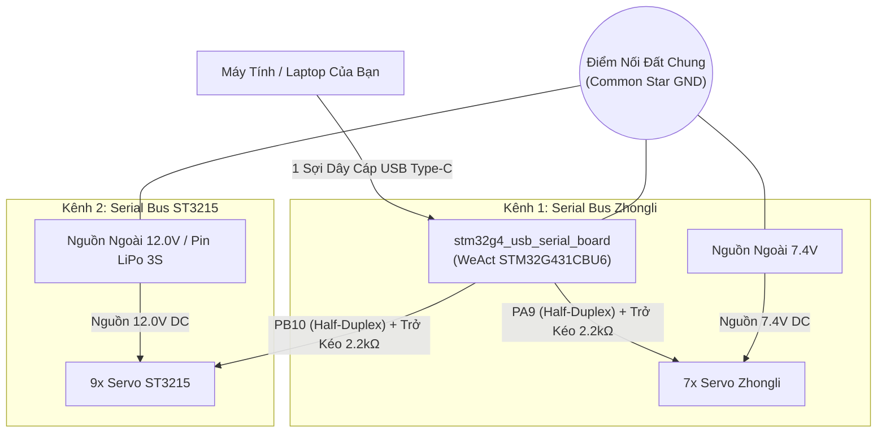

<!-- LANGUAGE SWITCHER -->
<p align="right">
  <a href="README.md">English</a> | <b>Tiếng Việt</b>
</p>

# stm32g4_usb_serial_board

<p align="center">
  
  
  
  
  
</p>

<p align="center">
  <b>Bo mạch chuyển đổi USB thông minh 2 kênh độc lập tốc độ cao dành cho servo Zhongli và Waveshare ST3215 trên robot.</b>
</p>

<p align="center">
  
</p>

---

## 🌟 Dự án này là gì và giải quyết vấn đề gì?

Khi phát triển các hệ thống robot phức hợp (như robot di động đa hướng kết hợp cánh tay robot 7 khớp), bạn thường phải điều khiển đồng thời hai loại động cơ serial bus:
1. **Chuỗi servo Zhongli:** Giao tiếp qua lệnh mã chữ ASCII (ví dụ cánh tay gắp vật).
2. **Chuỗi servo Waveshare ST3215 / Feetech:** Giao tiếp qua khung gói nhị phân STS tốc độ cao 100 Hz (ví dụ bánh xe omniwheel hoặc khớp robot LeKiwi).

<p align="center">
  
  &nbsp;
  
</p>

Nếu dùng các bo USB-UART thông thường hoặc gắn chung trên 1 đường truyền, hệ thống sẽ gặp các vấn đề nghiêm trọng:
- Xung đột giao thức giữa mã nhị phân STS và mã chữ ASCII.
- Trễ truyền nhận (Latency > 30ms), làm giật cánh tay và trượt bánh robot.
- Xung đột driver hoặc thiếu cổng kết nối độc lập cho các node ROS 2.

**`stm32g4_usb_serial_board`** giải quyết triệt để vấn đề này bằng cách biến vi điều khiển 32-bit **STM32G431CBU6 (ARM Cortex-M4F @ 170 MHz)** thành một **Cầu nối phần cứng thông minh 2 kênh độc lập (Dual-Port Hardware Bridge)**:
- **Kênh 1 (`/dev/zhongli_serial`):** Chạy `USART1` (PA9) Half-Duplex Open-Drain @ 1 Mbps dành riêng cho servo Zhongli.
- **Kênh 2 (`/dev/lekiwi_serial`):** Chạy `USART3` (PB10) Half-Duplex Open-Drain @ 1 Mbps dành riêng cho servo Waveshare ST3215.
- Máy tính chỉ cần cắm **đúng 1 sợi cáp USB Type-C**, hệ điều hành Linux sẽ tự động nhận diện thành **2 cổng serial độc lập** hoạt động song song với **sai số truyền tin bằng 0 (0.00% Baudrate Error)**!

---

## ⚡ Tại sao bo mạch này vượt trội hơn?

| Tiêu Chí So Sánh | Bo Chuyển Đổi Rẻ Tiền / Z-Link Cũ | Bo Mạch Dự Án Này (`stm32g4_usb_serial_board`) |
| :--- | :--- | :--- |
| **Số Kênh Điều Khiển** | Chỉ 1 kênh đơn | 🚀 **2 kênh độc lập chạy song song (Dual CDC)** |
| **Loại Servo Hỗ Trợ** | Chỉ 1 loại cố định | ✅ **Hỗ trợ đồng thời cả Zhongli (ASCII) & ST3215 (Binary STS)** |
| **Độ Mượt Điều Khiển** | Bị giật, trễ (10–20 lần/giây) | ⚡ **Mượt mà tuyệt đối 100 Hz (độ trễ phản hồi < 1.2 ms)** |
| **Sai Số Tín Hiệu** | Lỗi khung truyền 2–3% ở 1 Mbps | 🎯 **Chuẩn xác 100% (0.00% sai số baudrate ở 170 MHz)** |
| **Tự Động Mute Echo** | Bị dội tiếng vọng tự thân khi phát | 🛡️ **Tự động ngắt mạch thu phần cứng (Hardware RE Muting <10ns)** |
| **Tích Hợp ROS 2** | Dễ văng cổng, cần cắm nhiều đầu nối | 🤖 **1 cổng USB Type-C cung cấp 2 symlink udev cố định** |

---

## 🔌 Sơ Đồ Đấu Nối Vào Robot

Toàn bộ hệ thống được kết nối tinh gọn và an toàn:



### 3 Điểm Cần Nhớ Khi Đấu Dây:
1. **Dây Tín Hiệu Kênh 1 (Zhongli):** Chân **`PA9`** (Header P1 - Pin 11) nối dây Data màu vàng của servo Zhongli kèm điện trở kéo $2.2\text{ k}\Omega$ lên 3.3V hoặc 5V.
2. **Dây Tín Hiệu Kênh 2 (ST3215):** Chân **`PB10`** (Header P2 - Pin 14) nối dây Data màu vàng/trắng của servo ST3215 kèm điện trở kéo $2.2\text{ k}\Omega$ lên 3.3V hoặc 5V.
3. **Nguồn Nuôi & Tiếp Đất (Common GND):** Nguồn 7.4V nuôi Zhongli và nguồn 12V nuôi ST3215 phải **kẹp chung cực âm (GND) vào chân GND của bo mạch STM32** (cấu trúc Star Grounding).

> ⚠️ **Lưu Ý An Toàn:** Tuyệt đối không lấy nguồn từ cổng USB máy tính để nuôi động cơ servo. Dàn động cơ công suất lớn có thể ăn dòng từ 5A đến 10A, cắm trực tiếp sẽ gây cháy cổng USB của máy tính!

---

## 🚀 Hướng Dẫn Sử Dụng Nhanh

### Bước 1: Cài đặt quy tắc nhận diện cổng trên Linux (Ubuntu)
Sao chép file quy tắc udev để cố định tên 2 cổng COM ảo:
```bash
sudo cp udev_rules/99-dual-servo-bridge.rules /etc/udev/rules.d/
sudo udevadm control --reload-rules && sudo udevadm trigger
```

### Bước 2: Cắm cáp USB Type-C vào máy tính
Kiểm tra kết nối trong terminal:
```bash
ls -l /dev/zhongli_serial /dev/lekiwi_serial
```
Hệ điều hành sẽ nhận diện ngay:
- `/dev/zhongli_serial` $\rightarrow$ cổng truyền nhận servo Zhongli.
- `/dev/lekiwi_serial` $\rightarrow$ cổng truyền nhận servo Waveshare ST3215.

Đèn LED màu xanh dương (`PC6`) trên bo sẽ nhấp nháy đều đặn nhịp 1 Hz báo hiệu firmware đang hoạt động bình thường.

### Bước 3: Thử nghiệm truyền nhận serial nội bộ

#### Kiểm tra Kênh 1: Giao thức mã chữ ASCII Zhongli (`/dev/zhongli_serial`)
Mở serial terminal bằng `picocom`:
```bash
picocom -b 1000000 /dev/zhongli_serial
```
Gõ lệnh hỏi góc khớp 1:
```text
#001PRAD!
```
Động cơ sẽ phản hồi ngay lập tức:
```text
#001P1500!
```

#### Kiểm tra Kênh 2: Giao thức nhị phân Waveshare ST3215 (`/dev/lekiwi_serial`)
Kiểm tra trực tiếp phản hồi Ping khung nhị phân 1 Mbps qua Python (`pyserial`), hoàn toàn độc lập và không phụ thuộc vào ROS middleware:
```bash
python3 -c "
import serial
ser = serial.Serial('/dev/lekiwi_serial', 1000000, timeout=0.05)
# Ping Servo ID 1: Header [0xFF, 0xFF], ID [0x01], Len [0x02], Ping [0x01], Checksum [0xFB]
ping_pkt = bytearray([0xFF, 0xFF, 0x01, 0x02, 0x01, 0xFB])
ser.write(ping_pkt)
resp = ser.read(6)
print('ST3215 Ping Response:', [hex(b) for b in resp])
# Kết quả kỳ vọng: ['0xff', '0xff', '0x1', '0x2', '0x0', '0xfc'] (Mã lỗi 0x00 OK)
ser.close()
"
```

---

## 🎮 Bảng Tra Cứu Lệnh Nhanh

### Cổng 1: Servo Zhongli (`/dev/zhongli_serial`)
- **Quay về góc giữa:** `#001P1500T0500!` *(Góc 1500 trong thời gian 500ms)*
- **Đọc vị trí hiện tại:** `#001PRAD!` *(Phản hồi `#001P1500!`)*
- **Đọc nhiệt độ & điện áp:** `#001PRTV!` *(Phản hồi `#001T28.5V7.4!`)*
- **Khóa lực giữ tư thế:** `#001PULR!` *(Phản hồi `#OK!`)*
- **Mở lực dạy học bằng tay:** `#001PULK!` *(Phản hồi `#OK!`)*

### Cổng 2: Servo Waveshare ST3215 (`/dev/lekiwi_serial`)
- **Định dạng gói:** `0xFF 0xFF <ID> <LEN> <INST> <PARAMS> <CHECKSUM>`
- **Đọc đồng thời 9 servo (SYNC_READ 100Hz):** Lệnh `0x82` đọc vị trí & vận tốc (`Reg 56..59`).
- **Ghi đồng thời vận tốc bánh xe (SYNC_WRITE):** Lệnh `0x83` đặt tốc độ (`Reg 46`).
- **Đọc chẩn đoán nhiệt độ, dòng điện, điện áp:** Lệnh đọc 15 bytes (`Reg 56..70`).

---

## 📚 Tài Liệu Kỹ Thuật Chuyên Sâu

Nếu bạn cần tra cứu sâu hơn về kiến trúc mạch điện tử, cấu hình DMA hoặc tích hợp hệ thống:
- 📖 [**Developer Quickstart Guide**](docs/guides/quickstart.md) — Hướng dẫn cài đặt toolchain, nạp firmware qua DFU / OpenOCD và gỡ lỗi.
- ⚡ [**Hardware & Electrical Specification**](docs/hardware/hardware-spec.md) — Phân tích chi tiết sơ đồ nguyên lý mạch, tính toán điện trở kéo sườn xung $t_r$ và phân phối nguồn 7.4V/12V.
- ⚙️ [**Firmware Architecture Specification**](docs/firmware/firmware-spec.md) — Cấu trúc C++17 `HalfDuplexUartChannel`, USB Composite IAD và vùng nhớ PMA.
- 🤖 [**ROS 2 & Protocol Integration**](docs/ros2/ros2-integration.md) — Kiến trúc tích hợp đa luồng ROS 2, phân tích băng thông bus 1 Mbps và quy tắc udev.
- 🤖 [**Quy Tắc Cho AI Coding Agent (AGENTS.md)**](AGENTS.md) — Bản tiêu chuẩn kỹ thuật dành cho các trợ lý lập trình trí tuệ nhân tạo.

---

## 🔗 Tài Liệu Tham Khảo & Kho Mã Nguồn Liên Quan

- [WeActStudio.STM32G431CoreBoard](https://github.com/WeActStudio/WeActStudio.STM32G431CoreBoard.git) — Sơ đồ nguyên lý phần cứng, sơ đồ chân và ví dụ xuất xưởng cho bo mạch WeAct STM32G431CBU6 CoreBoard.
- [lekiwi_ros2](https://github.com/DuyKhongCay/lekiwi_ros2.git) — Hệ thống ROS 2 và hardware interface cho robot LeKiwi, tích hợp servo nối tiếp Feetech / Waveshare ST3215.

---

## 📄 Giấy Phép (License)

Dự án được phát hành theo giấy phép mã nguồn mở [MIT License](LICENSE). Hoàn toàn tự do cho mục đích nghiên cứu, học tập và thương mại.
