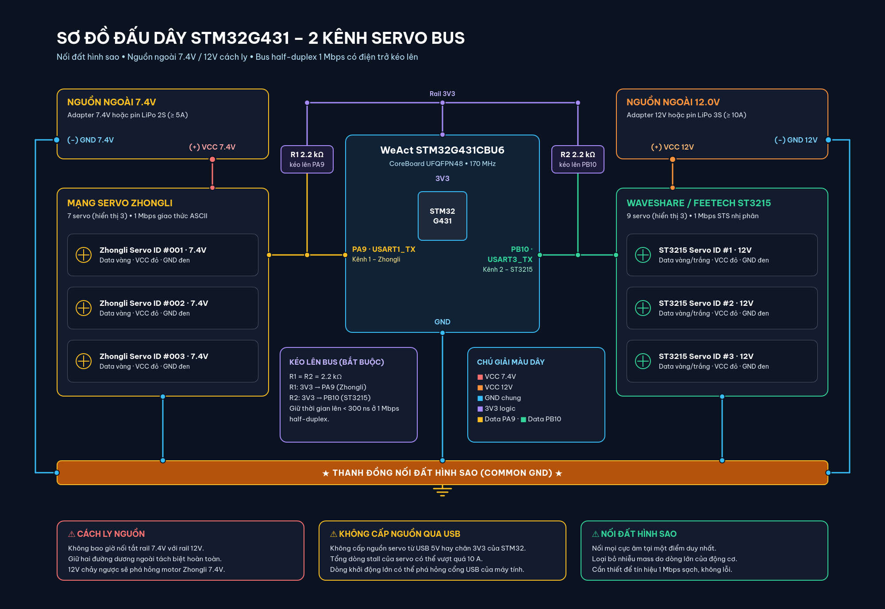

# Developer Quickstart Guide

This guide walks software, firmware, and robotics engineers through setting up the development environment, building the firmware, flashing the microcontroller, and verifying the **`stm32g4_usb_serial_board`** hardware from a clean Linux installation.

---

## 1. Prerequisites

### 1.1. Required Hardware
- **1x WeAct Studio STM32G431CBU6 CoreBoard** (UFQFPN48 package, 128 KB Flash, 32 KB SRAM).
- **1x USB Type-A to Type-C cable** (Recommended for stable 5V VBUS delivery; avoids Type-C CC termination issues).
- **1x ST-Link V2 / V3 programmer** (or use native USB DFU mode via BOOT0).
- **2x $2.2\text{ k}\Omega$ pull-up resistors** (1/4W through-hole or 0805/0603 SMD; one for PA9, one for PB10).
- **Power Supplies:**
  - **1x External 7.4V DC power supply** ($\ge 5\text{A}$ or 2S LiPo battery) for Zhongli 7.4V servo chain.
  - **1x External 12.0V DC power supply** ($\ge 10\text{A}$ or 3S/4S regulated LiPo) for Waveshare/Feetech ST3215 12V servo chain.
- **Servos:**
  - Zhongli intelligent bus servo(s) (3-pin JST-XH cable).
  - Waveshare / Feetech ST3215 serial bus servo(s) (3-pin 5264 cable).

### 1.2. Host Toolchain Installation (Ubuntu 20.04 / 22.04 / 24.04)
Install the ARM GNU embedded toolchain, CMake, Ninja, and flashing utilities:

```bash
sudo apt update
sudo apt install -y \
    gcc-arm-none-eabi \
    g++-arm-none-eabi \
    libnewlib-arm-none-eabi \
    cmake \
    ninja-build \
    openocd \
    dfu-util \
    picocom \
    python3-serial
```

### 1.3. Linux Host Udev Rules Configuration
To allow non-root flashing, stable device naming, and non-root serial access:

```bash
# Navigate to the project root
cd stm32g4_usb_serial_board

# 1. Install flashing udev rules (if available)
sudo cp resource/49-stlink-dfu.rules /etc/udev/rules.d/ 2>/dev/null || true

# 2. Install Dual-CDC symlink udev rules
sudo cp udev_rules/99-dual-servo-bridge.rules /etc/udev/rules.d/

# 3. Reload udev daemon
sudo udevadm control --reload-rules
sudo udevadm trigger

# 4. Add current user to the dialout group
sudo usermod -aG dialout $USER
# (Log out and log back in for group changes to take effect)
```

---

## 2. Firmware Build Workflow

The project uses modern CMake presets (`CMakePresets.json`) paired with Ninja:

```bash
# Navigate to the project root
cd stm32g4_usb_serial_board

# Configure and build Debug target (includes -g3 debug symbols)
cmake --preset Debug
cmake --build --preset Debug

# Configure and build Release target (size-optimized -Os)
cmake --preset Release
cmake --build --preset Release
```

### Inspect Firmware Memory Footprint
```bash
arm-none-eabi-size build/Release/stm32g4_usb_serial_board.elf
```
*Expected footprint (Release):*
- **Flash (text + data):** $\approx 22\text{ KB}$ ($\approx 17.0\%$ of 128 KB).
- **RAM (data + bss):** $\approx 10.4\text{ KB}$ ($\approx 31.9\%$ of 32 KB).

---

## 3. Flashing Firmware

### Option A: Via ST-Link Programmer (Recommended for Development)
Connect the 4 SWD pins between the ST-Link programmer and Header P3 on the WeAct board:
- ST-Link `3.3V` $\rightarrow$ WeAct P3 Pin 1 (`3.3V`)
- ST-Link `SWDIO` $\rightarrow$ WeAct P3 Pin 2 (`PA13`)
- ST-Link `SWCLK` $\rightarrow$ WeAct P3 Pin 3 (`PA14`)
- ST-Link `GND` $\rightarrow$ WeAct P3 Pin 4 (`GND`)

Flash using OpenOCD:
```bash
openocd -f interface/stlink.cfg -f target/stm32g4x.cfg \
    -c "program build/Release/stm32g4_usb_serial_board.elf verify reset exit"
```

### Option B: Via Native USB DFU Mode (Direct USB Cable)
1. Connect the WeAct board to your PC via a USB Type-C cable.
2. **Hold down the `BOOT0` button (SW1) $\rightarrow$ Press the `Reset` button (SW2) $\rightarrow$ Release `Reset` $\rightarrow$ Release `BOOT0` after 0.5s.**
3. Verify DFU mode enumeration:
   ```bash
   dfu-util -l
   # Expected output: Found DFU: [0483:df11] ver=2200, devnum=...
   ```
4. Flash the binary firmware:
   ```bash
   dfu-util -a 0 -s 0x08000000:leave -D build/Release/stm32g4_usb_serial_board.bin
   ```

---

## 4. Power-On State Verification

Immediately following a successful flash:

1. **Power LED (`D2` - Red):** Permanently lit, indicating a healthy 3.3V logic rail.
2. **Heartbeat LED (`D1` - Blue on `PC6`):** Toggles reliably every **500 ms** (1.0 Hz square wave), indicating that the FreeRTOS-less cooperative scheduler, PLL, and background tasks are running.
3. **USB Dual CDC-ACM Enumeration Check:**
   ```bash
   dmesg | tail -n 25
   ```
   *Expected kernel log:*
   ```text
   usb 1-1: new full-speed USB device number ... using xhci_hcd
   usb 1-1: New USB device found, idVendor=0483, idProduct=5740
   usb 1-1: Product: Dual USB CDC Serial Bridge
   cdc_acm 1-1:1.0: ttyACM0: USB ACM device (CDC0: Zhongli)
   cdc_acm 1-1:1.2: ttyACM1: USB ACM device (CDC1: ST3215)
   ```
4. **Udev Symlinks Verification:**
   ```bash
   ls -la /dev/zhongli_serial /dev/lekiwi_serial
   ```
   *Expected output:*
   ```text
   lrwxrwxrwx 1 root root 7 ... /dev/zhongli_serial -> ttyACM0
   lrwxrwxrwx 1 root root 7 ... /dev/lekiwi_serial -> ttyACM1
   ```

---

## 5. Hardware Wiring & Star Grounding

### 5.1. Physical Wiring Schematic

<p align="center">
  
</p>

> [!CAUTION]
> **Strict Power Domain Isolation:**  
> - **NEVER** power servos from the STM32 board's 3.3V or 5V VBUS pins.  
> - **NEVER** short the 7.4V and 12.0V positive rails together!  
> - **ALWAYS** tie the negative terminals of the 7.4V PSU, 12V PSU, and STM32 board GND together in a **Star Ground topology** at a single heavy-gauge junction point.

---

## 6. Functional Verification

### 6.1. Channel 1: Zhongli ASCII Servo Test
Connect to `/dev/zhongli_serial` using picocom:

```bash
picocom -b 115200 /dev/zhongli_serial
```

1. **Query position of Servo ID 001:**
   Type:
   ```text
   #001PRAD!
   ```
   *Immediate response from Servo:*
   ```text
   #001P1500!
   ```
2. **Move Servo ID 001 to position 2000 in 500 ms:**
   Type:
   ```text
   #001P2000T0500!
   ```

### 6.2. Channel 2: Waveshare / Feetech ST3215 Binary Test
Verify Channel 2 using Python and `pyserial`:

```python
import serial
import time

ser = serial.Serial('/dev/lekiwi_serial', 1000000, timeout=0.05)

# Ping Servo ID 1: Header [0xFF, 0xFF], ID [0x01], Len [0x02], Ping [0x01], Checksum [~(1+2+1) & 0xFF = 0xFB]
ping_pkt = bytearray([0xFF, 0xFF, 0x01, 0x02, 0x01, 0xFB])
ser.write(ping_pkt)
resp = ser.read(6)

print(f"Ping Response: {[hex(b) for b in resp]}")
# Expected response: ['0xff', '0xff', '0x1', '0x2', '0x0', '0xfc'] (Error code 0x00)
ser.close()
```

---

## 7. Troubleshooting Matrix

| Problem | Root Cause | Resolution |
| :--- | :--- | :--- |
| **`/dev/ttyACM*` does not appear when plugging USB** | Using a C-to-C cable without CC pull-down resistors on WeAct CoreBoard | Switch to a **USB-A to USB-C cable**, or bridge solder pads on SB8 and SB9 with a drop of solder. |
| **Only 1 CDC port appears (`ttyACM0` only)** | Old firmware without Composite IAD descriptor flashed | Rebuild and flash the new release firmware from `build/Release/stm32g4_usb_serial_board.bin`. |
| **Symlinks `/dev/zhongli_serial` or `/dev/lekiwi_serial` missing** | Udev rules not installed or udev daemon not triggered | Run `sudo cp udev_rules/99-dual-servo-bridge.rules /etc/udev/rules.d/ && sudo udevadm control --reload-rules && sudo udevadm trigger`. |
| **Blue Heartbeat LED (PC6) does not blink** | PLL fails to lock due to incorrect HSE crystal frequency selection | Verify that `SystemClock_Config()` configures `RCC_OSCILLATORTYPE_HSE` with an 8.000 MHz crystal source (standard on WeAct boards). |
| **Sent `#001PRAD!` but received no reply on Channel 1** | 1. Missing common ground between 7.4V PSU and STM32.<br>2. Missing external $2.2\text{ k}\Omega$ pull-up on `PA9`. | 1. Connect PSU negative terminal to WeAct GND.<br>2. Measure PA9 voltage when idle; it must read exactly $3.3\text{V}$. |
| **ST3215 Ping times out on Channel 2** | 1. External $2.2\text{ k}\Omega$ pull-up on `PB10` missing.<br>2. Servo baud rate mismatch (must be 1,000,000 bps).<br>3. 12V PSU is off or disconnected. | 1. Measure PB10 idle voltage ($3.3\text{V}$).<br>2. Verify 12V power supply to ST3215.<br>3. Verify servo ID and baud rate using Feetech calibration software. |
| **Servo twitches or resets randomly** | Severe voltage sag on the 7.4V or 12.0V rail during motor inrush | Solder a $470\mu\text{F} - 1000\mu\text{F}$ low-ESR electrolytic capacitor across the DC power rail near the servo bus root. |
