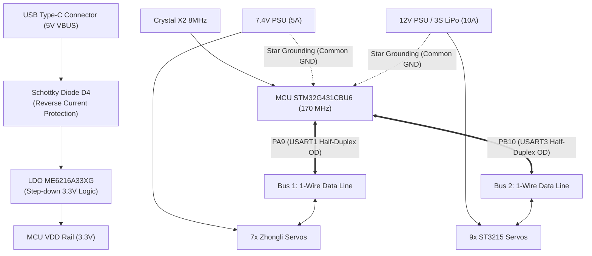

# Hardware & Electrical Specification

This document provides a comprehensive electrical and schematic audit report for the **WeAct Studio STM32G431CBU6 CoreBoard (UFQFPN48 V1.0)**, defines the standardized pinout matrix for STM32CubeMX, and outlines the dual-channel physical bus interface design for driving both Zhongli (7-DOF Arm) and Waveshare ST3215 (LeKiwi Robot) serial bus servos.

---

## 1. Microcontroller & Board Specifications

| Parameter | Specification | Engineering Notes |
| :--- | :--- | :--- |
| **Microcontroller (MCU)** | STMicroelectronics STM32G431CBU6 | ARM Cortex-M4F @ 170 MHz |
| **Package** | UFQFPN48 ($7 \times 7\text{ mm}$, 48 pins) | Compact core board form factor |
| **Memory** | 128 KB Flash / 32 KB SRAM | Includes zero-wait-state CCM-RAM |
| **Logic Operating Voltage** | 3.3V Logic ($1.71\text{V} - 3.6\text{V}$) | All communication pins (PA9, PB10) are 5V-Tolerant (FT) |
| **Main Oscillator (HSE)** | External crystal 8.000 MHz ($\pm 10\text{ppm}$) | Load capacitors $C_4 = C_5 = 10\text{ pF}$ |
| **USB Clocking** | Internal HSI48 with CRS (Clock Recovery System) | Native Crystal-less USB Full-Speed (12 Mbps, Dual CDC) |
| **Linear Voltage Regulator** | ME6216A33XG (or ME6239A33M3G) | $V_{in,\max} = 20\text{V} - 30\text{V}$, $I_{out} \approx 300\text{ mA}$ |

---

## 2. Electrical Architecture & Power Domains

The hardware architecture provides complete galvanic isolation between logic processing and the two high-current motor power rails:



### 2.1. Block 1: Power Domain & Regulation
- **Input Supply Path:** 5V incoming from USB Type-C (`VBUS`) passes through Schottky barrier diode `D4` (COD4, reverse bias protection) onto the `VCC` rail. `VCC` feeds Pin 1 of LDO `U2` (`ME6216A33XG`) which outputs the regulated `3.3V` logic rail.
- **Bulk Filtering:**
  - Regulator Input ($V_{in}$): Ceramic capacitors $C_{13} = 4.7\mu\text{F} / 25\text{V}$ and $C_{14} = 1\mu\text{F} / 25\text{V}$.
  - Regulator Output ($V_{out}$): Ceramic capacitor $C_{15} = 10\mu\text{F}$.
- **High-Frequency Decoupling:** Every individual $V_{DD}-V_{SS}$ pin pair on the MCU features a dedicated $100\text{ nF}$ high-frequency decoupling capacitor placed adjacent to the package pins (`C7`, `C8`, `C9`, `C12`), supplemented by a $1\mu\text{F}$ bulk capacitor (`C11`).
- **Analog Power Domain:** Ferrite bead `FB1` ($1\text{ k}\Omega\text{ @ 100 MHz}$) isolates digital switching noise on $V_{DD}$ from the sensitive analog rails $V_{DDA} / V_{REF+}$.

### 2.2. Block 2: Clock Network (HSE & PLL)
- **HSE (High-Speed External):** Crystal `X2` ($8.000\text{ MHz}$, XTAL3225, $\pm 10\text{ppm}$) is connected to pins `PF0-OSC_IN` and `PF1-OSC_OUT`. It serves as the reference clock for the main PLL, multiplying the system clock to **$170\text{ MHz}$**.
- **Zero Baudrate Error Guarantee:** With $SYSCLK = 170\text{ MHz}$, the fractional baud rate generator divider for $1,000,000\text{ baud}$ is exactly:
  $$\text{BRR} = \frac{170\,000\,000}{1\,000\,000} = 170.0$$
  This yields **$0.00\%$ baudrate error** on both USART1 and USART3.

---

## 3. Pinout Assignment Matrix for STM32CubeMX

| MCU Pin | Net Name (Schematic) | Header Pin | CubeMX Mode | Detailed Configuration | Actual Project Function | Electrical Characteristics |
| :--- | :--- | :--- | :--- | :--- | :--- | :--- |
| **PA9** | `USART1_TX` | **P1 - Pin 11** | `Single Wire (Half-Duplex)` | Alternate Function Open-Drain, Speed High, External Pull-up 2.2k | **1-Wire Data Line: 7x Zhongli Servos** | **5V-Tolerant (FT)** |
| **PB10**| `USART3_TX` | **P2 - Pin 14** | `Single Wire (Half-Duplex)` | Alternate Function Open-Drain, Speed High, External Pull-up 2.2k | **1-Wire Data Line: 9x ST3215 Servos** | **5V-Tolerant (FT)** |
| **PA11**| `USB_DM` | P1 - Pin 13 | `USB_Device (FS)` | D- Differential Data | USB Type-C Port Data- | Managed by USB IP |
| **PA12**| `USB_DP` | P1 - Pin 14 | `USB_Device (FS)` | D+ Differential Data | USB Type-C Port Data+ | Managed by USB IP |
| **PA13**| `SWDIO` | P3 - Pin 2 | `SYS_JTMS-SWDIO` | Internal Pull-Up | SWD Debug Data | Dedicated |
| **PA14**| `SWCLK` | P3 - Pin 3 | `SYS_JTCK-SWCLK` | Internal Pull-Down | SWD Debug Clock | Dedicated |
| **PC6** | `PC6` | **P1 - Pin 9** | `GPIO_Output` | Push-Pull, Low Speed, Default Low | **Heartbeat LED D1 (Blue, 1 Hz)** | Sinking/Sourcing $\approx 0.4\text{ mA}$ |
| **PC13**| `PC13` | **P2 - Pin 24** | `GPIO_Input` | GPIO Input, **Internal Pull-Down** | **User Key (SW3)** | Reads Logic 1 when pressed |

---

## 4. Dual 1-Wire Half-Duplex Bus Interface Design (@ 1,000,000 Baud)

### 4.1. Dual Open-Drain Hardware Schematic
```text
[ STM32G431CBU6 ]
       |
  Pin PA9 (USART1_TX)   -------\
  (Open-Drain Mode)             |
                                +----------------------------> [ ZHONGLI SERVO DATA ]
                                |                              (Yellow wire)
                               [R1] Pull-up Resistor (2.2kΩ)
                                |
                       +3.3V or +5V Supply Rail
                                |
                               [R2] Pull-up Resistor (2.2kΩ)
                                |
  Pin PB10 (USART3_TX)  --------+----------------------------> [ ST3215 SERVO DATA ]
  (Open-Drain Mode)                                            (Yellow / White wire)
```

### 4.2. Pull-Up Resistor Sizing & Rise-Time Calculations
At $1,000,000\text{ baud}$, bit duration is $T_{\text{bit}} = 1.0\mu\text{s}$.
- A multi-servo daisy chain exhibits cumulative parasitic bus capacitance $C_{\text{bus}} \approx 100\text{ pF} - 150\text{ pF}$ across wiring and connector pins.
- When the bus is released into high-impedance state (Hi-Z), the rising edge time ($t_r$) is governed by the $RC$ time constant:
  $$t_r \approx 2.2 \times R_{\text{pull}} \times C_{\text{bus}}$$
- **With $R_{\text{pull}} = 2.2\text{ k}\Omega$:**
  $$t_r \approx 2.2 \times 2200\Omega \times 120\text{ pF} \approx 0.58\mu\text{s} < 0.6 \times T_{\text{bit}}$$
  *(Strongly recommended for both harnesses to maintain sharp edges and eliminate UART framing errors)*.

---

## 5. Dual Power Supply Isolation & Grounding Guidelines

> [!CAUTION]
> **Never draw servo motor power from the STM32 board's 3.3V or 5V rails!**  
> Simultaneous acceleration current across 16 servos reaches **$8\text{ A} - 15\text{ A}$**. Powering them from USB will cause immediate brownout and destroy the host computer's USB root hub.

### Industrial Wiring Standards:
1. **Independent Power Rails:**
   - Supply regulated $7.4\text{V} - 8.4\text{V}$ (rated for $\ge 5\text{A}$) to the Zhongli arm servos.
   - Supply $11.1\text{V} - 12.6\text{V}$ (3S LiPo or 12V 10A PSU) to the Waveshare ST3215 servos.
2. **Star Grounding (Common Ground):** Tie the negative terminals (GND) of both power supplies directly to the STM32 GND pin at a single star junction point. This ensures identical reference potential ($0\text{V}$) across both communication buses.
3. **Transient Suppression:** Place a $470\mu\text{F} / 25\text{V}$ low-ESR electrolytic capacitor and a $100\text{ nF}$ ceramic capacitor in parallel at the power entry point of each servo chain to absorb inductive kickback voltages.
