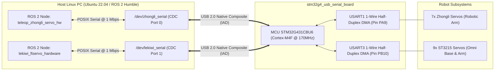

# ROS 2 Integration & Protocol Specification

This document provides complete integration guidelines for connecting the **`stm32g4_usb_serial_board`** to the **ROS 2 (Humble / Iron / Jazzy)** robotics framework. It covers dual-node concurrent execution, details both the Zhongli ASCII and Feetech STS binary communication protocols, and analyzes bus timing for closed-loop operation at **50 Hz – 100 Hz**.

---

## 1. System Integration Architecture

The STM32G431 microcontroller functions as an ultra-fast, hardware-isolated dual bridge between the Host Linux PC and the two independent robot servo chains:



---

## 2. Linux Host Configuration & udev Rules

### 2.1. Kernel Driver Detection
Upon plugging the USB Type-C cable into the Host PC, the Linux kernel automatically binds the `cdc_acm` driver and enumerates two Virtual COM ports:
```bash
dmesg | grep cdc_acm
# Expected:
# cdc_acm 1-1:1.0: ttyACM0: USB ACM device (Interface 0 - Zhongli)
# cdc_acm 1-1:1.2: ttyACM1: USB ACM device (Interface 2 - ST3215)
```

### 2.2. Persistent Static Symlinks (`/dev/zhongli_serial` & `/dev/lekiwi_serial`)
To prevent device name swapping, install the project udev rule:
```bash
sudo cp udev_rules/99-dual-servo-bridge.rules /etc/udev/rules.d/
sudo udevadm control --reload-rules && sudo udevadm trigger
```

Content of `/etc/udev/rules.d/99-dual-servo-bridge.rules`:
```udev
# Interface 0 -> Zhongli Serial Bus (7-DOF Arm ASCII)
SUBSYSTEM=="tty", ATTRS{idVendor}=="0483", ATTRS{idProduct}=="5740", ENV{ID_USB_INTERFACE_NUM}=="00", SYMLINK+="zhongli_serial", MODE="0666", GROUP="dialout"

# Interface 2 -> Waveshare ST3215 / LeKiwi Serial Bus (STS Binary)
SUBSYSTEM=="tty", ATTRS{idVendor}=="0483", ATTRS{idProduct}=="5740", ENV{ID_USB_INTERFACE_NUM}=="02", SYMLINK+="lekiwi_serial", MODE="0666", GROUP="dialout"
```

---

## 3. Protocol Specifications

### 3.1. Zhongli ASCII Protocol (`/dev/zhongli_serial`)
Framing structure: `#` + `<3-digit Servo ID>` + `<Command String & Parameters>` + `!`

| Functional Group | Host Command String | Servo Response Frame | Technical Description |
| :--- | :--- | :--- | :--- |
| **Position Move** | `#001P1500T0500!` | *(No response)* | Drive Servo ID 1 to target position `1500` over `500ms`. |
| **Read Position** | `#001PRAD!` | `#001P1500!` | Query present position (potentiometer / magnetic encoder). |
| **Read Telemetry**| `#001PRTV!` | `#001T28.5V7.4!` | Read board temperature (`28.5°C`) and voltage (`7.4V`). |
| **Lock Torque** | `#001PULR!` | `#OK!` | Enable motor torque to maintain position. |
| **Unlock Torque** | `#001PULK!` | `#OK!` | Disable motor torque for manual lead-through teaching. |
| **Calibrate Zero**| `#001POS+015!` | `#OK!` | Apply $+15$ unit mechanical offset. |
| **Emergency Stop**| `#001PSTP!` | *(No response)* | Instantly halt motor PWM drive. |

---

### 3.2. Waveshare ST3215 / Feetech STS Protocol (`/dev/lekiwi_serial`)
Framing structure:
`[0xFF] [0xFF] [ID] [Length] [Instruction] [Parameters...] [Checksum]`
Where `Checksum = ~(ID + Length + Instruction + sum(Parameters)) & 0xFF`.

| Instruction Opcode | Name | Parameters | Description |
| :--- | :--- | :--- | :--- |
| `0x01` | `PING` | None | Verify presence and responsiveness of servo. |
| `0x02` | `READ` | `Address, Count` | Read consecutive control table registers. |
| `0x03` | `WRITE` | `Address, Data...` | Direct write into control registers. |
| `0x82` | `SYNC_READ` | `Address, Count, ID1, ID2...` | High-speed multi-servo query in a single frame. |
| `0x83` | `SYNC_WRITE`| `Address, Count, [ID, Data]...`| Broadcast target setpoints across multiple servos simultaneously. |

#### Key Register Map (ST3215):
- `Reg 33`: Operating Mode (`0`: Position, `1`: Velocity, `2`: PWM).
- `Reg 40`: Torque Enable (`0`: Disable, `1`: Enable).
- `Reg 42`: Goal Position (2 bytes, 0..4095).
- `Reg 46`: Goal Speed (2 bytes, sign-magnitude).
- `Reg 56`: Present Position (2 bytes, 0..4095).
- `Reg 58`: Present Speed (2 bytes, sign-magnitude).
- `Reg 62`: Present Voltage ($0.1\text{V}$ resolution).
- `Reg 63`: Present Temperature ($1^\circ\text{C}$ resolution).

---

## 4. Bus Timing & Bandwidth Analysis @ 1 Mbps

At **$1,000,000\text{ baud}$**, each bit duration is $1.0\mu\text{s}$, yielding $10\mu\text{s}$ per byte (8N1 serial frame).

### 4.1. Zhongli 7-Servo Query Cycle (Channel 1)
- Query command: 9 bytes $\rightarrow$ $90\mu\text{s}$ TX.
- Turnaround delay: $\approx 50\mu\text{s}$.
- Response frame: 10 bytes $\rightarrow$ $100\mu\text{s}$ RX.
- Total per servo: $\approx 240\mu\text{s}$.
- **Complete 7-servo query cycle:** $7 \times 240\mu\text{s} \approx \mathbf{1.68\text{ ms}}$ (Leaves $>8\text{ ms}$ idle time at 100 Hz).

### 4.2. ST3215 9-Servo Fast Feedback Loop (Channel 2)
In LeKiwi robot, `lekiwi_ftservo_hardware` issues a `SYNC_READ` for registers 56..59 (Position + Speed, 4 bytes):
- Command frame: `FF FF FE 0B 82 38 04 ID1..ID9 Checksum` (17 bytes) $\rightarrow$ **$170\mu\text{s}$ TX**.
- 9 servos respond sequentially with 8-byte status packets:
  $$9 \times (8\text{ bytes} \times 10\mu\text{s} + 30\mu\text{s}\text{ turnaround}) \approx 9 \times 110\mu\text{s} \approx \mathbf{990\mu\text{s}}$$
- **Total `SYNC_READ` transaction duration:** $170\mu\text{s} + 990\mu\text{s} \approx \mathbf{1.16\text{ ms}}$.
- At **$100\text{ Hz}$** ($10.0\text{ ms}$ period), total bus utilization is only **$11.6\%$**, ensuring zero contention and pristine real-time determinism.
